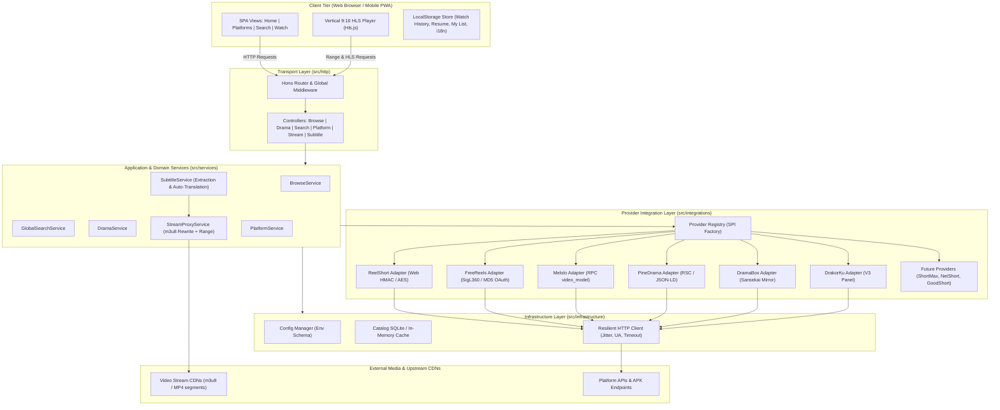

# ARCHITECTURE.md — DramaboxD Architecture Blueprint

> **Status:** Living Document  
> **System Name:** DramaboxD  
> **System Scope:** Enterprise-grade Local Micro-Drama (Dracin) Streaming Platform & Aggregator  
> **Benchmark Reference:** [https://dramaflix.net/](https://dramaflix.net/)  
> **Core Directives:** Clean Layered Architecture, Strict No Layer Skipping, Zero Hardcoding, Provider SPI Modular Pattern.

---

## 1. Architecture Overview & Design Principles

DramaboxD is designed as a modular, high-performance, self-hosted streaming web platform and media aggregator specialized in vertical (9:16) micro-dramas. The platform aggregates catalog metadata and playback streams from multiple third-party providers (ReelShort, FreeReels, PineDrama, DramaBox, Melolo, DrakorKu, and future platforms) while offering a seamless Netflix/DramaFlix-style viewing experience with local persistence, multi-language UI (i18n), and automatic subtitle handling.

### Core Architectural Invariants (Non-Negotiable Rules)
1. **Strict Layered Separation (No Layer Skipping):**
   * **Presentation / Transport Layer (`http/`):** Handles HTTP routing, input validation, serialization, and status codes. Never executes business logic, database queries, or external HTTP calls directly.
   * **Application / Service Layer (`services/`):** Contains pure domain use-cases and orchestration. Interacts with data stores via Repositories and external platforms via Integration Clients.
   * **Integration / Provider Layer (`integrations/providers/`):** Encapsulates reverse-engineered APIs, signature generation (HMAC/MD5), envelope decryption (AES/zlib), and stream normalization. Each provider implements a common Service Provider Interface (`DramaProvider`).
   * **Infrastructure Layer (`infrastructure/`):** Cross-cutting concerns such as environment configuration, logging, disk/SQLite caching, and resilient HTTP transports.
2. **Zero Hardcoded Secrets & Dynamic Configuration:**
   * No hardcoded API keys, secrets, base URLs, or client device identifiers. All configurable values must flow through validated environment schemas (`infrastructure/config`).
3. **Pluggable Provider SPI (Service Provider Interface):**
   * Adding a new provider requires implementing the `DramaProvider` contract and registering it in the Provider Registry without mutating existing domain services or transport handlers.
4. **Resilient Local Caching & Rate-Limit Shield:**
   * Upstream provider APIs are protected by a localized cache layer (SQLite/In-Memory) to avoid upstream rate-limiting, IP bans, or latency bottlenecks during catalog browsing.

---

## 2. Target Project Structure

To decouple monolithic legacy files (`src/server.ts`, `public/app.js`) and ensure enterprise-level maintainability, the codebase follows this modular layout:

```text
DramaboxD/
├── src/
│   ├── index.ts                      # Application bootstrap & entrypoint
│   ├── http/                         # Transport Layer
│   │   ├── app.ts                    # Hono application factory & global middlewares
│   │   ├── middlewares/              # CORS, error handling, request logging, security headers
│   │   ├── controllers/              # Request handlers (Input -> Service -> JSON/Stream)
│   │   │   ├── browse.controller.ts
│   │   │   ├── drama.controller.ts
│   │   │   ├── search.controller.ts
│   │   │   ├── platform.controller.ts
│   │   │   ├── stream.controller.ts
│   │   │   └── subtitle.controller.ts
│   │   └── routes/                   # Route declarations mapped to controllers
│   │       ├── api.routes.ts
│   │       └── static.routes.ts
│   │
│   ├── services/                     # Business Logic Layer
│   │   ├── browse.service.ts         # Aggregated catalog, billboard highlights, row curation
│   │   ├── drama.service.ts          # Drama detail, episode resolution, unlock validation
│   │   ├── search.service.ts         # Multi-provider concurrent search & ranking
│   │   ├── platform.service.ts       # Platform registry directory, availability & metrics
│   │   ├── subtitle.service.ts       # HLS subtitle track extraction & on-the-fly translation
│   │   └── stream-proxy.service.ts   # Range requests, m3u8 playlist URI rewriting, referer spoofing
│   │
│   ├── integrations/                 # External Integrations Layer
│   │   └── providers/                # Pluggable Provider Modules (SPI)
│   │       ├── contracts/            # Provider interfaces (DramaProvider, RawEnvelope)
│   │       │   └── provider.contract.ts
│   │       ├── registry.ts           # Provider factory & dynamic registration
│   │       ├── reelshort/            # Web API (HMAC-SHA256, AES-CBC-128, m3u8)
│   │       ├── freereels/            # APK API (SigL360, MD5 OAuth guest session)
│   │       ├── melolo/               # APK API (RPC video_model, MP4 direct)
│   │       ├── pinedrama/            # Web RSC/JSON-LD parser (signed MP4 play URLs)
│   │       ├── dramabox/             # Upstream API adapter & normalization
│   │       ├── drakorku/             # Korean drama panel client (cid categories)
│   │       └── mock/                 # Deterministic fixtures for unit testing & offline dev
│   │
│   ├── infrastructure/               # Technical Infrastructure Layer
│   │   ├── config/                   # Strongly-typed environment parser & validation
│   │   ├── logger/                   # Structured logging (pino / custom console)
│   │   ├── cache/                    # Persistent catalog storage & TTL cache (SQLite/KV)
│   │   └── http/                     # Resilient HTTP client (timeout, retry, jitter delay, UA)
│   │
│   └── shared/                       # Shared Domain Contracts & Utilities
│       ├── types/                    # Domain models: SeriesSummary, SeriesDetail, Episode, SubtitleTrack
│       ├── errors/                   # Domain & HTTP exceptions (ProviderUnavailableError, StreamError)
│       └── utils/                    # M3U generator, string slugify, URL normalizers
│
├── public/                           # Frontend Client Application (SPA)
│   ├── index.html                    # Single-Page Application root shell
│   ├── css/
│   │   ├── variables.css             # Theme design tokens (#08080A, Netflix red, glass surfaces)
│   │   ├── base.css                  # Typography, reset, responsive layout grid
│   │   ├── components.css            # Cards, billboard hero, episode drawers, pills, badges
│   │   └── player.css                # Vertical 9:16 player styling, seekbars, control overlays
│   │
│   └── js/
│       ├── app.js                    # SPA router & application initializer
│       ├── api/                      # Fetch client wrapping backend endpoints (/api/*)
│       ├── i18n/                     # Internationalization dictionaries (ID 🇮🇩, EN 🇬🇧)
│       ├── store/                    # Reactive client state (Watch history, continue watching, favorites)
│       ├── components/               # Modular UI rendering components
│       │   ├── navbar.js             # Navigation bar, search toggle, language switcher
│       │   ├── billboard.js          # Hero drama showcase & featured CTA
│       │   ├── drama-card.js         # Vertical poster cards with platform tags & episode badge
│       │   ├── platform-grid.js      # Platform directory cards (39+ platforms view)
│       │   ├── episode-drawer.js     # Numeric pills (1..N) & episode list with thumbnail
│       │   └── vertical-player.js    # 9:16 mobile-first HLS player with auto-next, skip ±10s, sub menu
│       └── views/                    # View controllers
│           ├── home.view.js
│           ├── platforms.view.js
│           ├── search.view.js
│           └── watch.view.js
│
├── fixtures/                         # Upstream mock JSON responses for CI tests
├── test/                             # Automated test suite (node:test)
├── docs/                             # Teardown analysis & reverse engineering documentation
├── package.json
├── tsconfig.json
└── ARCHITECTURE.md
```

---

## 3. High-Level System Architecture Diagram



---

## 4. Core Components & Responsibilities

### 4.1 Backend Components

#### 1. Transport Layer (`src/http`)
* **Role:** Entry point for HTTP communication.
* **Responsibilities:**
  * Route handling via lightweight Hono framework.
  * Validation of query parameters and route params (`q`, `provider`, `id`, `epIndex`).
  * Response serialization and HTTP status mapping.
  * Error boundary middleware preventing unhandled upstream exceptions from leaking stack traces.

#### 2. Service Layer (`src/services`)
* **BrowseService:** Aggregates trending and latest releases across active providers. Manages hero billboard selection and row curation with TTL caching.
* **GlobalSearchService:** Executes parallel searches across all available providers using `Promise.allSettled()`, deduplicates titles, and returns unified search results with provider badges.
* **DramaService:** Fetches normalized series metadata and episode catalogs. Checks lock status and prepares playable stream metadata.
* **StreamProxyService:** Proxies video streaming traffic:
  * Implements HTTP `206 Partial Content` (Range requests) for fast seeking in MP4/M3U8.
  * Rewrites HLS playlist URIs (`#EXT-X-STREAM-INF`, TS segments, encryption keys) so relative segment paths route back through the local proxy.
  * Dynamically injects upstream `Referer`, `Origin`, and `User-Agent` headers matching each provider's CDN protection policies.
* **SubtitleService:**
  * Detects and extracts subtitle tracks from HLS manifests or provider episode payloads.
  * Provides on-the-fly VTT translation to target language (e.g., English/Chinese → Indonesian) for automated subtitle support.

#### 3. Provider Integration Layer (`src/integrations/providers`)
Each provider is an isolated module conforming strictly to `DramaProvider`:
```typescript
export interface DramaProvider {
  readonly name: string;
  readonly displayName: string;
  readonly isEnabled: boolean;
  search(query: string): Promise<SeriesSummary[]>;
  latest(): Promise<SeriesSummary[]>;
  trending(): Promise<SeriesSummary[]>;
  detail(id: string): Promise<SeriesDetail>;
  episodes(id: string): Promise<Episode[]>;
}
```

---

### 4.2 Frontend Client Components (`public/`)

The frontend operates as a modular Single-Page Application (SPA) designed specifically for vertical micro-drama playback:

1. **State Store (`public/js/store/`):**
   * Persists to browser `localStorage`.
   * `watchHistory`: Map of `{ seriesId: { provider, title, cover, lastEpisode, lastPositionSeconds, updatedAt } }`.
   * `favorites`: Array of bookmarked dramas ("My List").
   * `userPreferences`: Selected interface language (`id` / `en`), autoplay toggle, preferred playback speed.
2. **Internationalization (`public/js/i18n/`):**
   * Pure dictionary mapping for Indonesian (`id`) and English (`en`).
   * Reactive DOM updates without page refresh.
3. **Vertical Player (`public/js/components/vertical-player.js`):**
   * Centered 9:16 aspect ratio container with dark theater backdrop.
   * Built on `Hls.js` with automated fallback to native HLS.
   * Features: Skip -10s / +10s, speed controls (1.0x, 1.25x, 1.5x, 2.0x), auto-play next episode toggle, and subtitle selector overlay.
4. **Platform Hub (`public/js/views/platforms.view.js`):**
   * Grid display modeled after `dramaflix.net/id/platforms` showing active vs coming soon platforms with drama count counters.

---

## 5. Data Stores & Caching Architecture

| Scope | Storage Engine | Strategy | Invalidation / TTL |
|---|---|---|---|
| **Browse / Catalog Cache** | SQLite (`better-sqlite3` or Bun SQLite) / In-Memory Map | Write-through on fetch | 15–30 minutes TTL |
| **Provider Episode Cache** | Key-Value Table (`series_id` -> `episodes_json`) | Stale-while-revalidate | 60 minutes TTL |
| **Watch History & Resume** | Client `localStorage` / `IndexedDB` | Immediate client-write | Persistent across sessions |
| **User Settings & My List** | Client `localStorage` | Immediate client-write | Persistent across sessions |

---

## 6. Security, Streaming & CORS Considerations

1. **CORS & Anti-Hotlinking Bypass:**
   * Upstream video segments often check `Origin` or `Referer` (e.g., PineDrama returns 500/403 to raw curl; ReelShort verifies browser UA). The `/api/stream` endpoint acts as an authenticated tunnel replacing incoming headers with legitimate browser headers.
2. **SSRF (Server-Side Request Forgery) Protection:**
   * The proxy endpoint `/api/stream?url=<target>` must validate that target URLs match known trusted CDN domains (e.g., `*.crazymaplestudios.com`, `*.mydramawave.com`, `*.ibyteimg.com`, `*.pinedrama.com`) or conform to standard public HTTP/HTTPS formats, prohibiting internal/LAN IP addresses (`127.0.0.1`, `10.*`, `192.168.*`, `169.254.*`).
3. **LAN Streaming Security:**
   * Bound to `0.0.0.0` to permit smart TVs, tablets, and smartphones on the same home WiFi network to stream without external token requirements.

---

## 7. Migration & Modular Implementation Plan

To evolve the existing prototype into this enterprise structure safely:

```
[Phase 1: Foundation & Dependencies]
  ├── Install package dependencies & typecheck baseline
  └── Establish infrastructure/config and shared/types

[Phase 2: Backend Modularization]
  ├── Refactor src/server.ts into http/ (routes & controllers) and services/
  ├── Add /api/search/global and /api/platforms endpoints
  └── Enhance /api/stream proxy with adaptive referer spoofing

[Phase 3: Subtitle & Multilingual Engine]
  ├── Update Episode schema with subtitle tracks
  ├── Add HLS subtitle track extraction in stream proxy
  └── Add i18n client dictionary (ID / EN)

[Phase 4: Frontend DramaFlix UI Evolution]
  ├── Overhaul public/ into modular views & components
  ├── Implement 9:16 vertical theatre player with ±10s skip & auto-next
  ├── Build Platforms Directory view (39+ platforms hub)
  └── Implement Continue Watching (watch history persistence)

[Phase 5: Automated Verification & Smoke Testing]
  ├── Verify all existing unit tests pass (33/33 tests)
  └── Smoke test browser playback & multi-device LAN access
```

---

## 8. Glossary & Project Identification

* **Micro-Drama (Dracin):** Short-form serialized video content shot in portrait 9:16 orientation, typically 1–2 minutes per episode, with 30–100 episodes per title.
* **SPI (Service Provider Interface):** Software design pattern where providers implement a common interface registered into a central runtime registry.
* **HLS (HTTP Live Streaming):** Adaptive video streaming protocol utilizing `.m3u8` playlists and `.ts` media segments.
* **Range Request (HTTP 206):** Byte-range retrieval enabling instant seeking and smooth buffer loading in video players.
